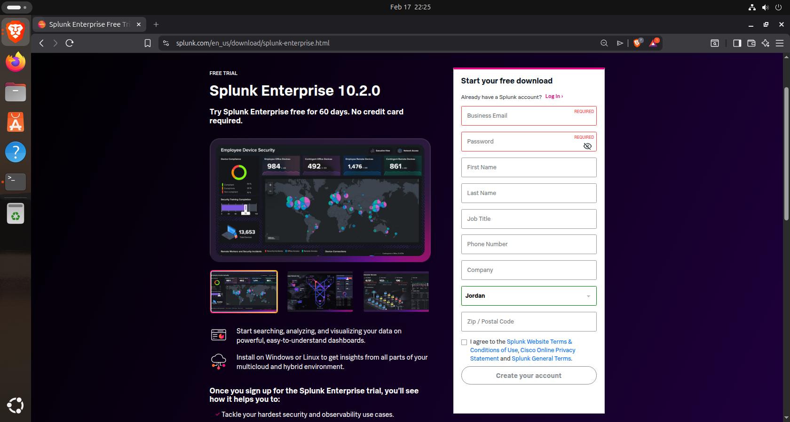
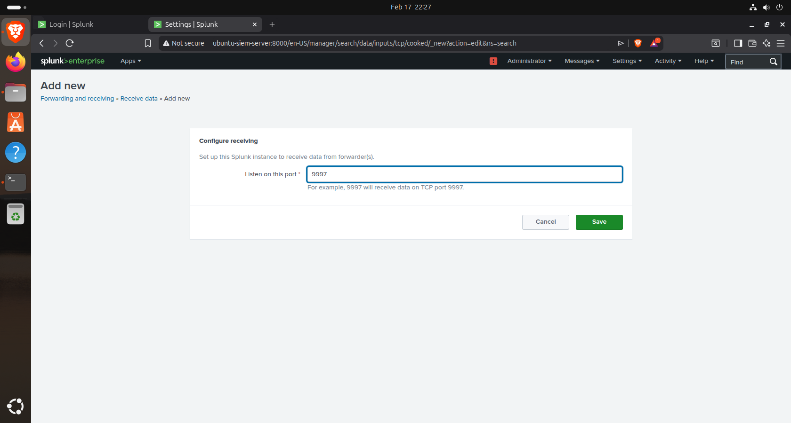
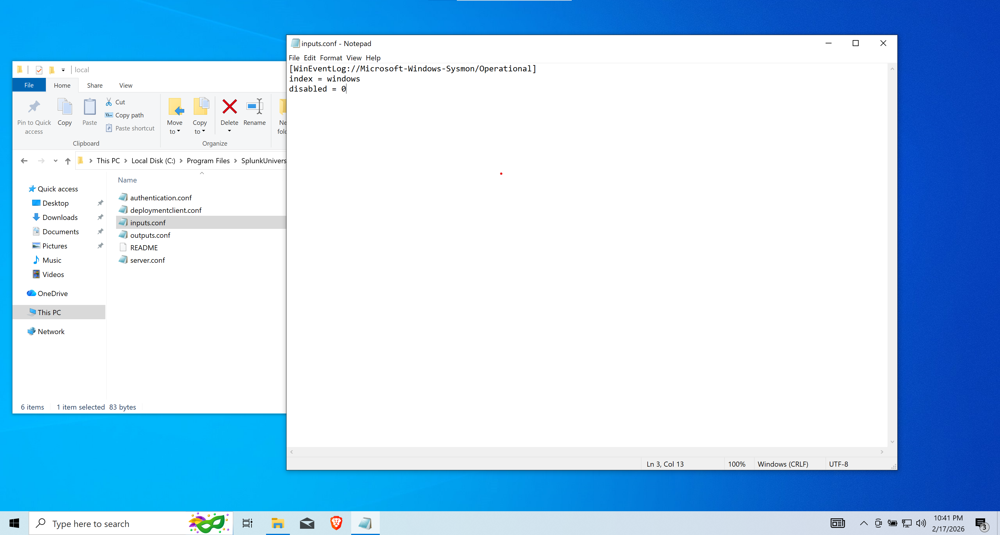
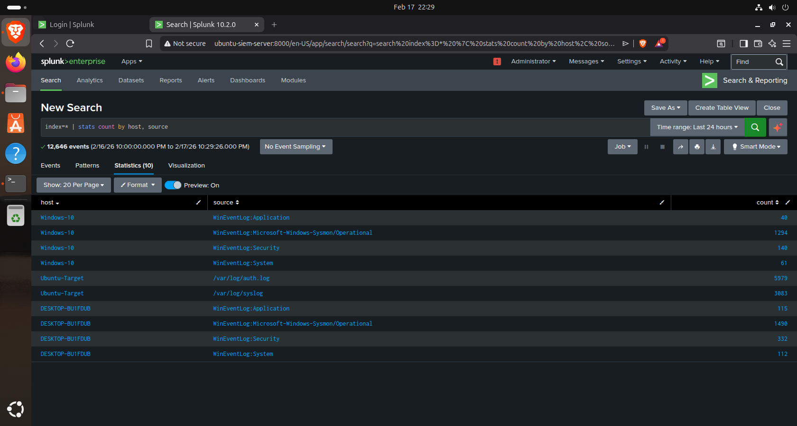
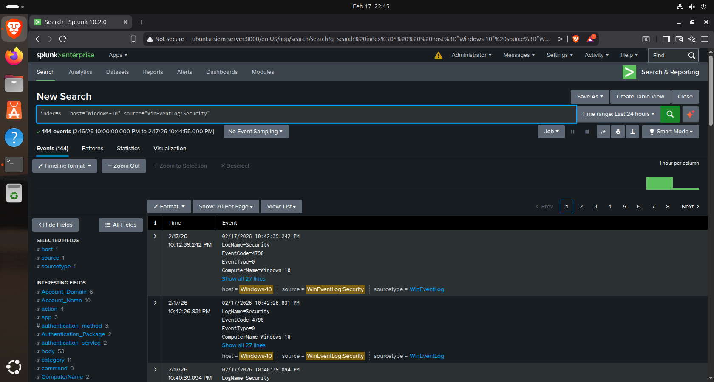
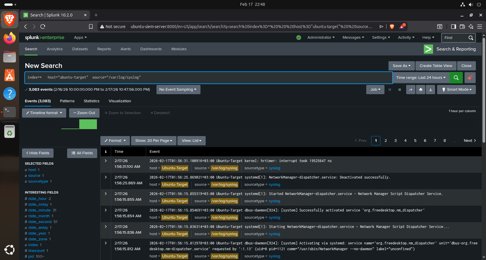

# Splunk Home Lab for Learning and Practice

This lab provides a simple, easy-to-understand home lab setup for **Splunk**.

Splunk is a powerful platform for searching, monitoring, and analyzing machine-generated data. Setting up a Splunk home lab is a great way to get hands-on experience with log collection and analysis. In this guide, I’ll walk through installing Splunk Enterprise on a host machine and configuring a Splunk Universal Forwarder on client computers to send logs to the Splunk server.

## My Splunk Home Lab Setup
For this lab, I used a virtualized environment to simulate a real corporate network.

- **SIEM Server**: I installed **Splunk Enterprise** on an **Ubuntu 24.04.4 LTS** server. This acts as the central brain, receiving and indexing all logs.
- **Client Machines**: I used **Windows 10** and **Ubuntu** virtual machines acting as endpoints. On the **Windows** machine, I installed **Sysmon** (System Monitor) for granular logging and the **Splunk Universal Forwarder** to ship those logs to the server. On the **Ubuntu** machine, I configured **Syslog** and installed the **Splunk Universal Forwarder** to ship system logs to the server.

I aim to create a simple, instructional guide that’s easy to use, reflecting my own learning experience. I want to highlight the challenges I faced during my foundational learning phase and the difficulties I had in finding straightforward, easy-to-follow resources online, without overwhelming people with complexity.

## Prerequisites
- A host computer (Ubuntu) for installing Splunk Enterprise.
- Client computers (Windows/Linux) for installing Splunk Universal Forwarder.
- Basic networking knowledge (IP addresses, ports).

---

## Step 1: Install Splunk Enterprise on the Host Server
1.  **Download**: I downloaded Splunk Enterprise (Linux .deb package) from Splunk's official website.
2.  **Install**: I installed it using `dpkg` and created an admin username and password.
    
3.  **Access**: I accessed the Splunk Web interface by navigating to `http://<Server-IP>:8000`.

## Step 2: Set up the Receiving Port
1.  **Navigate**: Go to **Settings** -> **Forwarding and Receiving**.
2.  **Configure**: Added a new receiving port (**9997**) under "Receive Data". This ensures the server is listening for incoming logs.
    

## Step 3: Install Splunk Universal Forwarder on Client
1.  **Download**: On the Windows machine and Ubuntu machine, I downloaded the Universal Forwarder.
2.  **Install**: During installation, I pointed it to my Splunk Server's IP address and port 9997.
3.  **Sysmon Integration**: To get better data than standard Windows logs, I installed **Sysmon** with the SwiftOnSecurity configuration on the Windows machine.
4.  **Configuration**: I edited the `inputs.conf` file to tell the Forwarder to send Sysmon logs to Splunk.
    

## Step 4: Monitor & Analyze Logs
1.  **Search**: Back in the Splunk Web interface, I went to **Search & Reporting**.
2.  **Verify**: I typed `index=*` to verify that data was flowing from my Windows machine.
3.  **Analyze**: I simulated a few actions (like creating a user or running a PowerShell command) and watched the logs appear in real-time.
    
    
    

---

## Conclusion
This is a simple and straightforward method to set up a Splunk home lab. I struggled to figure out the setup initially, especially connecting the Linux SIEM server with both Windows and Linux endpoints, but I managed to get it working. I hope you find this an easy way to set up your own SIEM lab.

## License
This project is licensed under the **MIT License**. See the [LICENSE](LICENSE) file for details.
